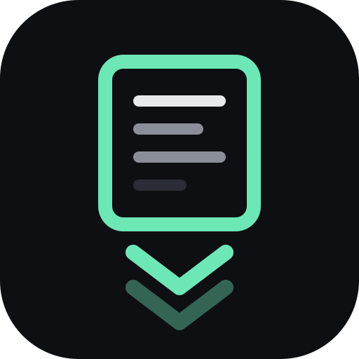

<p align="center">
  
</p>

<h1 align="center">Follow</h1>

<p align="center">Auto-scrolling PDF presenter. Open a PDF, set a speed, press play.</p>

Runs entirely in the browser: no backend, no storage. The PDF is held in memory and is gone when the tab closes.

## Structure

```
.
├── index.html
├── manifest.webmanifest
├── .nojekyll
├── assets/
│   ├── logo.svg
│   ├── favicon.ico
│   ├── apple-touch-icon.png
│   ├── icon-192.png
│   └── icon-512.png
├── styles/
│   ├── base.css       tokens, reset, buttons, empty state
│   ├── toolbar.css    top bar
│   └── viewer.css     pages, progress bar
└── scripts/
    ├── config.js      namespace, constants, state, storage, DOM refs
    ├── viewer.js      PDF.js loading + lazy page rendering
    ├── scroller.js    auto-scroll loop, speed, progress
    ├── ui.js          toolbar, shortcuts, zoom, fullscreen, drag & drop
    └── main.js        entry point
```

Scripts are classic (non-module) and load in the order listed in `index.html`, so the page also works opened straight from disk.

## Controls

| Key | Action |
| --- | --- |
| `Space` | Play / pause |
| `↑` / `↓` | Speed ±5 px/s |
| `+` / `−` | Zoom |
| `F` | Fullscreen |
| `Home` | Back to top |

Manual scrolling takes over at any time; Play continues from where you are.

## Run locally

Open `index.html` in a browser (needs internet once for PDF.js from cdnjs).

## Deploy (GitHub Pages)

```bash
git init -b main
git add .
git commit -m "Initial commit"
git remote add origin https://github.com/V1ron6/follow.git
git push -u origin main
```

Then on GitHub: **Settings → Pages → Build and deployment → Deploy from a branch → `main` / `(root)`**.
Live at `https://v1ron6.github.io/follow/`.
